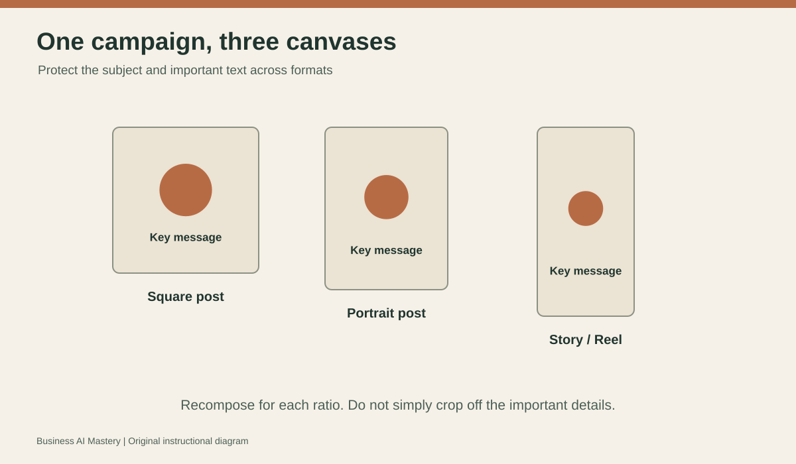

# From one researched idea to several channel formats

> **Updated:** 20 November 2026. Interface, account access and available models can change.



*Original instructional artwork. Diagram labels are conceptual, not screenshots of a vendor interface.*

## Repurpose the thought, not the sentence

Take a verified customer question such as “How do I choose the right basket size?” The long answer can be a useful article or demonstration. Instagram may need a visual comparison. Facebook may need a short FAQ. WhatsApp may need a concise reply with approved measurement details.

### Make an asset map

| Channel | Main reader need | Appropriate asset |
| --- | --- | --- |
| Instagram | See the size difference | Two real photographs with dimensions |
| Facebook | Understand the choice | FAQ with an authentic image |
| WhatsApp | Receive one direct answer | Short personalised reply with permission |
| Website | Evaluate all specifications | Full product entry |

### Prompt

```text
Rewrite this approved answer for four channels without adding any claims. Keep the dimensions exactly. For each channel explain what the reader needs to know first, the recommended visual, and the correct next step. Identify any missing permission or source asset.
```

### Review visual crops

A horizontal photograph may lose the scale reference in a tall crop. Recompose it rather than stretching. Make sure text never crosses on screen interface elements or important product details.

**Exit test:** Each version says something true and useful in a form suited to that channel.

## Platform adaptation notes

### Adapt the idea, not just the dimensions

A long article might contain six supporting arguments. An Instagram carousel cannot carry them all without becoming crowded. A short video benefits from one demonstration. A Facebook notice may need a clearer address and action. A LinkedIn post may need a professional implication and source. A WhatsApp summary needs brevity and permission based delivery. Platform adaptation is an editorial decision, not merely a resize button.

An educational carousel should move from a specific question to an explanation, then a worked example, a common error and a useful check. Keep one central teaching point on each frame. An infographic should display a relationship or process visually. If the information remains clearer as a paragraph, there is no need to force it into boxes and icons.

### Presentations and reports

A presentation is a live argument supported by slides, not a report scattered across rectangles. Each slide should answer one question, show the evidence needed for that answer and leave details for the speaker. A report can carry more nuance, methods, limitations and source notes. Never manufacture a chart from illustrative figures without clearly labelling them as hypothetical.

### Accessibility as part of design

Use legible sizes and sufficient contrast, add accurate captions, give meaningful visuals descriptive alternatives where the format permits, and avoid conveying important meaning only through colour. Check content at the actual viewing size. For multilingual audiences, verify translations with appropriate language expertise when a mistake would matter. Generated speech and automatic captions need special attention to names and local pronunciation.

## What to retain for the next cycle

Record the authoritative source note and a checklist linking each shared fact to the caption, carousel, video, web page and scheduled post. A change should be made everywhere it appears.

[Return to the index](../README.md) · [Case studies](../05-real-world-examples/complete-campaign.md)

## Repurposing is rewriting for a different moment of attention

Start with a researched customer question: *How do I choose a basket size?* A long article might explain measurements and use cases. A carousel teaches comparison step by step. A Reel shows the actual basket beside common household items. A WhatsApp status can announce that both sizes are available for viewing, if confirmed. The central facts stay fixed; the audience's attention and the form of proof change.

```text
From this approved size guide, make five distinct outputs: a 300-word
web explanation, a five-frame carousel outline, a 20-second filming
plan, a 60-word Facebook caption and a brief WhatsApp status.
Preserve all measurements exactly. Each output should answer the buyer
in its own format rather than repeating the same words. Do not infer
stock or fabricate questions from customers.
```

**Consistency sheet:** make a one-row record for each factual attribute and check whether it appears correctly on the relevant platform. Re-export and recheck content after a change to price, availability or opening hours. Keep screenshots of the published result and note which platform interface may obscure on-screen text.

**Measure usefulness:** saves and relevant questions may matter more for an educational carousel; enquiries and purchases may matter more for a confirmed offer. Avoid one universal engagement score across formats.
