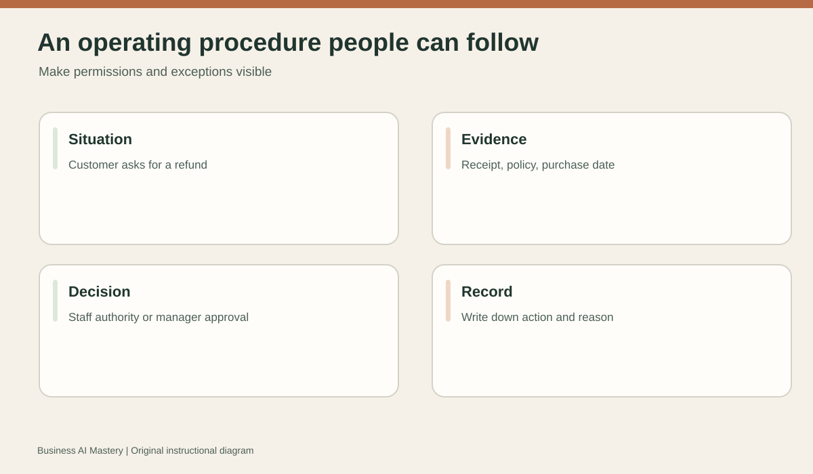

# Staff planning, handovers and operating procedures



Schedules and staff procedures are sensitive. A system may help summarise requirements or suggest a roster, but it should not infer private employee circumstances or make unsupported performance judgements. Treat payroll, employment rules and safety instructions as matters requiring current policy and, where needed, qualified advice.

## Build a roster from real constraints

Record opening hours, required roles, shift duration, minimum staffing, approved availability, leave and any mandatory rest rules. Use staff identifiers only when permitted. A shift plan is valid only if it satisfies each constraint and has been approved by the relevant manager.

```text
Build a *proposed* seven-day roster for a fictional four-person shop.
Use the attached approved availability table, operating hours and
minimum staffing requirement. Show a coverage matrix by hour, note
unfilled shifts and explain any conflicts. Do not invent availability,
assume employees accept overtime or publish the schedule. If the
constraints are impossible, state that clearly and propose questions.
```

## Create procedures that survive real pressure

A procedure is a sequence with a trigger, owner, inputs, action, evidence and escalation. Write an opening checklist, then simulate a missing key, internet outage and customer complaint. If the procedure does not say what an employee should do when a step cannot be completed, it is incomplete.

## Humanisation for internal communication

Employees need direct instruction, not motivational filler. *If the terminal fails, take the customer's contact information through the approved secure process and notify the supervisor* is more useful than *maintain service excellence*, provided the first sentence is actual company policy. Do not publish staff personal information in public examples.

[Return to workflows](../README.md)
