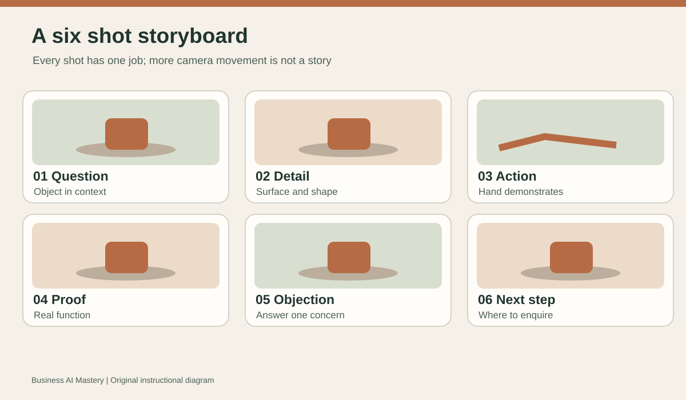
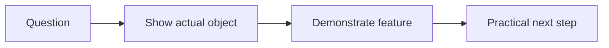

# A 30 second narrated product video

> **Updated:** 20 November 2026. Interface, account access and available models can change.



*Original instructional artwork. Diagram labels are conceptual, not screenshots of a vendor interface.*

## Make meaning before motion

A short product video should answer one question. In this exercise, a fictional pottery studio shows how the lid of a jar closes. A real jar is required if the clip represents a product for sale.

| Time | Visual | Narration purpose |
| --- | --- | --- |
| 0 to 4 seconds | Jar and lid in the same frame | Ask a useful question |
| 4 to 10 seconds | Actual close view of lid edge | Identify the part |
| 10 to 19 seconds | Uninterrupted demonstration | Show the closure action |
| 19 to 25 seconds | Final resting position | Explain what to observe |
| 25 to 30 seconds | Plain product image and contact | Offer a next step |

### Spoken script direction

Draft for ordinary breath and pace. Avoid phrases that would sound unnatural if a real shopkeeper spoke them. Test names and abbreviations with the actual narrator. Keep room tone when it helps the scene, but lower music enough for clarity.

```text
Prepare a 30 second script and six shot storyboard from these recorded clips. Do not describe features that the footage cannot demonstrate. For every shot include duration, camera framing, the exact words spoken, on screen text and the source clip ID. Finish with a list of facts to confirm.
```

### Production review

Watch without sound. Listen without looking. Then watch with captions. Inspect hand movement, label integrity and any generated frame continuity. Label realistic synthetic media where required.

**Exit test:** Someone can accurately describe the demonstrated function without relying on exaggerated claims.

## Technical production principles

### A video needs a reason to move

A model may animate anything. That does not make the motion useful. Before producing footage, decide what the audience must understand at each second. A product video may reveal scale, a tutorial may demonstrate a hand movement, and a documentary clip may let someone finish a thought. Motion should carry information or emotion, not merely prove that motion is possible.



### Three routes to a finished video

**Real footage first:** capture the subject using a phone or camera, edit out dead time, correct exposure and sound, then add carefully verified text. This is usually the most truthful option for products, staff and events.

**Generated scene first:** create fictional environments, concept shots or illustrative sequences using a video generator, then select only those clips that withstand inspection. Use a separate editor for order, pace, sound and captions.

**Hybrid production:** record a person or product in reality while using generated backgrounds, explanatory overlays or abstract transitions where appropriate. Keep a clear account of what is real and what is simulated. Do not use synthetic motion to imply that an event actually occurred.

### Camera language that prompts can use

A **static shot** holds framing and lets the subject move. A **pan** rotates horizontally. A **tilt** rotates vertically. A **dolly** changes the camera’s physical distance. A **tracking shot** follows an action. A **push in** makes a detail grow in importance. A **top view** explains arrangements on a table. State one principal movement for a short generated clip unless the production specifically requires a complicated move.


### Video generation prompt

> Use the supplied reference still as the first frame. Keep the cup’s silhouette, handle and matte surface unchanged. Duration approximately five seconds. The cup remains stationary on a wooden table. Camera makes a small, slow move from left to right at table height. Soft window light remains fixed on the left. The background plant moves only slightly. No floating objects, shape changes, new text or sudden cuts. The motion should feel like a careful product demonstration.

A video generator may not obey every restriction. The editor must compare opening and final frames, check object persistence, and look for contact surfaces that slide, hands that melt or objects that appear from nowhere. Short controlled shots are easier to validate than long scenes with several interacting people.

### Editing order

Build the rough cut first. Remove shots that do not advance the meaning. Put the strongest truthful evidence where the viewer needs it. Record or generate narration after the storyline is clear. Level the voice, correct captions, then add music quietly if it serves the piece. Finish with colour and export checks. Transitions come last. A cut is often the clearest transition.

### A complete thirty second structure

Seconds 0 to 4 show a question in visual form: how large is the object in the hand? Seconds 4 to 11 show a stable close view and its real measurements. Seconds 11 to 20 demonstrate a useful detail through natural action. Seconds 20 to 26 answer the remaining question using verified information. Seconds 26 to 30 give one unambiguous next step. Exact timing will change with spoken pace and the number of facts.

### Spoken writing differs from page writing

The listener cannot scan backward as easily as a reader. A voiceover should introduce one idea, make it understandable and move on. Long noun phrases and stacked clauses sound stiff when spoken. Say the script aloud before generation. Mark pronunciations of personal names, places, brands, quantities and uncommon terms. Check unfamiliar local words with a person who knows how they are said.


### A natural recording is a performance

A credible voice has breath, emphasis and pauses that fit the meaning. The goal is not to add arbitrary stutters or artificial mistakes. For a calm educational explanation, shorten the sentences, leave space around the important definition and avoid constant sales excitement. For a lively event notice, natural energy may be appropriate. The choice depends on speaker, audience and content.

With generated speech, select a voice before attempting detailed adjustments. Test a short representative paragraph. Then adjust speed, stability or delivery controls where the model offers them. Change only one control before listening again. Keep a pronunciation sheet, especially when multiple chapters or videos share the same names.

### Loudness and intelligibility

Start by reducing background noise only as much as needed. Overprocessing can make a real voice watery or metallic. Correct sudden loud and quiet passages with careful level automation or compression. Make speech intelligible on a low cost phone speaker as well as headphones. Avoid music that masks consonants. Check every caption against the actual recorded audio, not just the original script.

### An actionable voice direction

> Narrate this demonstration for adults choosing handmade tableware. Speak clearly and warmly, as a knowledgeable craft maker explaining a real object. Aim for approximately thirty seconds. Maintain ordinary conversational speed and pause after the measurement. Do not sound like a trailer announcer. Use the approved script exactly; flag difficult pronunciations instead of guessing. Return the cleaned script with a short pronunciation list.

### Consent and representation

A convincing voice can still be the wrong choice. Do not clone a real person’s voice without the necessary authority and platform compliance. Some services permit only self verification for certain cloning products even when another person has agreed. Record permission, scope of use, languages, duration, channels and revocation arrangements where relevant. Never create a fake customer interview or an endorsement from an invented speaker presented as real.

## What to retain for the next cycle

Keep footage, spoken script, pronunciation notes, rights and consent records, caption transcript, project timeline and exported version together. Note which shots are illustrative or generated.

[Return to the index](../README.md) · [Case studies](../05-real-world-examples/complete-campaign.md)

## Voice-directed video: an actual timed construction

Use the following fictional 25-second structure for a local stationery shop. **0 to 4:** genuine hand placing the notebook on a table, ambient sound. **4 to 9:** open the actual notebook; caption identifies verified paper format. **9 to 16:** show the binding in a close-up, with narration explaining a real feature. **16 to 21:** show the notebook next to a ruler or pen for scale. **21 to 25:** plain text card with approved shop contact. The precise footage determines the final cut.

**Script direction:** write 45 to 55 conversational words for this length as a starting estimate, then record and measure rather than forcing the speech to fit. A voice actor or synthetic narrator should be allowed to pause after the factual point. Music should remain below the voice and never hide a number or brand name.

```text
Write a 25-second narration to the five verified shots and source facts.
Do not invent what the paper feels like, how long the binding lasts or
how customers react. Use everyday spoken words, one statement per shot,
and mark proper nouns for pronunciation review. Then return a table
with time, shot, narration, caption and asset source. Flag any sentence
that cannot fit naturally in its allotted time.
```

**Three-pass review:** watch silently for visual explanation, listen without the screen for narrative meaning, then watch with captions to inspect alignment. Correct the underlying error before adding effects. A generated clip may be suitable as an atmospheric insert, but it cannot stand in for evidence of the actual notebook's construction.
