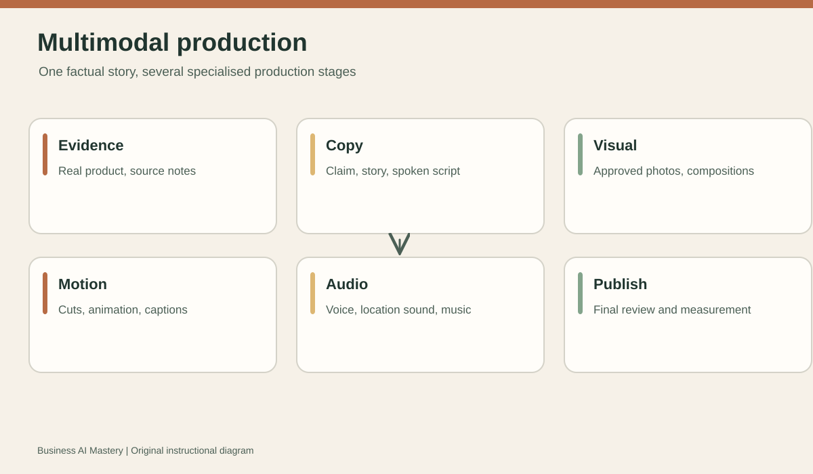

# A complete campaign: one story in six formats

> This is a **fictional teaching case**, not an account of actual customer transactions, staff or businesses. Replace example values and claims with verified material before any real use.



## Fictional campaign brief

A small ceramics studio wants enquiries about a new workshop. Approved source fields are the workshop title, date, venue, fee, booking method and capacity. For this exercise, leave actual values as placeholders, because copying a fictional offer into a live advert would be misleading.

### 1. Build an evidence register

| Field | Authoritative source | Approved? |
| --- | --- | --- |
| Date and time | Signed event sheet | Pending |
| Fee | Owner’s current price list | Pending |
| Location | Venue confirmation | Pending |
| Capacity | Organiser's written limit | Pending |

### 2. Write the content

Draft one clear headline about what participants will learn. Produce a useful FAQ, not a slogan list. From the approved facts, prepare a Facebook post, Instagram caption and WhatsApp response, each with its own purpose.

### 3. Build the visuals

Photograph real materials and work in progress, with consent. Use a poster layout with clean hierarchy and one true scene. Make a five panel carousel answering practical attendee questions. Never add a fake testimonial or past attendance statistic.

### 4. Film a 30 second video

Use the real workspace, hands working with materials, actual demonstration and a short spoken invitation. Record a test narration, check pronunciation and add truthful subtitles. Use generated footage only for clearly illustrative scenes and handle platform disclosures.

### 5. Schedule and learn

Set the objective as qualified workshop enquiries. Track source, useful messages and verified bookings. Compare outcomes to the original brief. The final report should distinguish what happened from why it may have happened.

**Final deliverables:** approved brief, fact register, three captions, poster, five panel carousel, narrated video, publishing schedule and outcome report. Keep all editable sources.

## An editorial production sequence from the original workbook

### The commission

The fictional studio Nala Clay has approved photographs of a mug and a short video showing its handle and glaze. It wants one Instagram poster, one thirty second vertical demonstration, a five panel educational carousel and three caption variants. Its audience wants trustworthy information about the product before visiting. No price or delivery promise is yet approved.


### Research and facts

Make a source sheet with material, actual dimensions, finish, care instructions, shop contact and visit details. Record who provided each fact. Hold incomplete fields out of public copy. If product measurements are unavailable, the video can show scale with a real hand, but any written size claim must wait for measurement.

### Script and shot plan

Opening: a real hand lifts the cup at ordinary speed. Voice: “Wondering how this cup feels in the hand?” Next a close view shows the rim and handle. Voice: “Here is the shape and finish, shown in daylight.” Then the person places the cup on a table and turns it once. Final screen: “Visit the studio to see it for yourself” plus approved contact details. The wording is intentionally modest. A maker who has verified additional details can replace the general line with actual care and measurement information.

### Poster and carousel

The poster uses one large real photograph, a concise title, sufficient white space and one action. The carousel answers five practical questions: what is pictured; what the surface looks like; how to assess handle comfort; what care instructions are confirmed; and how to inspect the product in person. Each panel gives a reason to advance rather than repeating the same slogan.

### Editing and publication

Use the real footage as the foundation. Choose music only if it improves comprehension and the usage rights permit it. Check that the captions accurately reflect the voice. Export a short preview and inspect on a phone. Once the client approves, adapt the written captions for the intended platform. Measure useful enquiries, not merely reach, and note what questions viewers asked after publication.

### How to judge the result

Ask a person unfamiliar with the studio what the item is, what they know for sure and what they would do next. If they cannot answer, the content is not finished. Compare this outcome with the initial objective. A perfectly generated background that prevents the audience from understanding the cup is a failure of communication.


## Questions to discuss after the exercise

1. Which product fact must remain unchanged across all six formats?
2. Where might a generated visual alter the actual product?
3. What must be rechecked after an approved price change?
4. Which customer question would guide the next campaign revision?

[Return to the index](../README.md)

## Expanded workshop: one source pack, six deliverables and a correction log

A complete campaign is a controlled publishing project. Start with one approved source pack and name the owner who can resolve questions. For this fictional product launch, imagine a small pottery studio introducing a hand-thrown mug. The product's capacity is measured and recorded, but it does not yet have an approved claim about dishwasher safety. A photographer has captured the actual object in window light.

### Stage one: evidence and creative brief

Write the approved product name, material, dimensions, inventory status, collection address, price if authorised and contact method. Attach the original image. Create a versioned brief with the audience question: *Does the mug fit my usual coffee portion and how does it look in hand?* The core message is practical, not a claim of luxury or craftsmanship beyond the evidence.

### Stage two: six distinct outputs

1. **Product page:** fact-based description and measured dimensions.
2. **Hero image:** actual photograph with clean layout and room for text.
3. **Poster:** headline, item and one verified detail, readable on a phone.
4. **Short film:** actual hand holding and turning the mug, with captions.
5. **Voiceover:** one natural sentence about dimensions and inspection.
6. **FAQ carousel:** capacity, shape, care unknown, collection information and how to ask a question.

### Stage three: a failure and repair sequence

The first generated concept places a silver handle on the mug and adds a glamorous fake stone showroom. The problem is not merely aesthetic: the handle is now the wrong material. Repair by using the actual photograph for the product, restricting image generation to the background and checking a side-by-side overlay. The first voiceover says *crafted for every occasion*, which adds nothing. Replace it with a supported description of capacity or measured dimensions.

### Stage four: prompt with source control

```text
From the approved mug product record, produce a consistency checklist
for six deliverables. Create rows for the exact product name, capacity,
material, dimensions, availability, contact and any wording restrictions.
For each deliverable say whether the item appears and where it should
be verified. Do not guess missing values. Mark the dishwasher-safety
claim as not approved. Include an owner approval column.
```

### Stage five: publish and learn

Before posting, preview each format on its destination screen and verify every shared fact. After publication, observe real enquiries, product-page visits and any questions suggesting confusion. Use those questions to update the FAQ for the next campaign. Keep drafts, approvals and final exports together so a later reviewer can reconstruct how the content was made.
