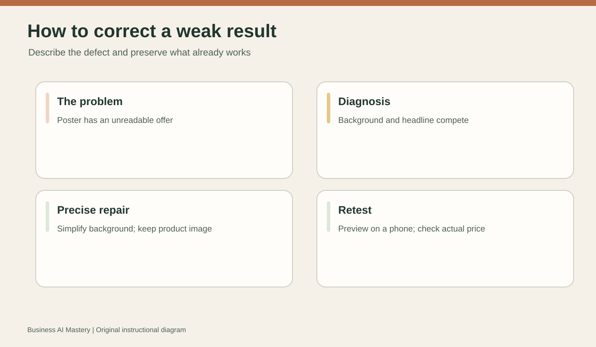

# A small creative agency: briefs and approvals

> This is a **fictional teaching case**, not an account of actual customer transactions, staff or businesses. Replace example values and claims with verified material before any real use.



## Fictional brief

An agency produces posts and short videos for three fictional clients: a bakery, a clothes shop and a service provider. All have different audiences, product truths and brand voices. Reusing one universal style would destroy their differences.

### Client folders

Each client gets a brief, evidence ledger, voice examples, rights log and decision record. Keep each company's material separate. Do not upload one client's confidential files into a shared assistant project accessible to another client.

### Prompt sequence

```text
Review the approved brief for Client B only. List every required asset, the source of its claims, the person responsible for approval and any missing inputs. Draft three distinct creative angles based on Client B’s genuine customer questions. Do not imitate another client’s palette, language or testimonials.
```

### The review loop

An art director checks the visual, an editor checks the wording, the client checks facts and an account manager checks permissions and deliverables. Give feedback as precise corrections: move the product, change a false date, shorten a sentence. Avoid endless “make it more premium” requests.

### Delivery

Save editable masters, final exports, the last approved prompt and a revision history. A source asset should not be overwritten by an experimental edit. Include a short note about any generated illustrative media and required labels.

**Result to measure:** Fewer revision rounds, accurate brand distinctions and a clear audit trail.

## Questions to discuss after the exercise

1. What prevents one client’s confidential facts from appearing in another account?
2. Which person approved each public claim and image?
3. How does the agency count revisions that reflect real improvements?
4. Does the client’s approved language differ meaningfully from other clients?

[Return to the index](../README.md)

## Extended case: a small agency working across multiple clients

The agency has three clients: a restaurant, a clothing brand and a service provider. Its most expensive mistake would be publishing one client's price, voice, photograph or customer information in another's campaign. Context management and approval boundaries matter as much as writing quality.

### Client workspace structure

Keep a private approved source packet for each client: contract scope, factual brief, brand voice examples, imagery rights, price list, approved contacts and revision log. Store drafts in separate locations. Reusable processes can live in a common library, but client facts must not. Label every output with client, date, version, current status and reviewer.

```text
For Client B only, use the attached approved November content brief and
product photos. Draft a four-post plan for Instagram. Each post must
show the actual source for factual claims. Do not use names, slogans,
colours, offers, statistics or examples from Clients A or C. Mark all
proposed creative decisions for approval. Report any missing source.
```

### Approval board

Use stages `brief received`, `evidence checked`, `draft`, `client review`, `revisions`, `approved`, `scheduled` and `published`. Keep approval for price, rights, customer testimonials and synthetic media clearly attributable. Do not let scheduled publishing bypass a delayed approval simply to meet a calendar deadline.

### Measure the agency's real efficiency

Track minutes from brief to approved asset, substantive revision count, corrections after publication and outcome relevant to each client. A 20-second generation that requires three hours of fixing is not a faster process. Review whether the initial brief supplied enough context and whether staff used appropriate tool choices.

### Humanisation across clients

The agency must learn each client's actual voice from approved material. Restaurant copy may be warm and immediate; a technical service company may need precise steps. Avoid giving every account the same energetic introduction, emoji pattern and decorative poster design. Distinctiveness should come from the organisation's real character, not arbitrary differences in colour.
