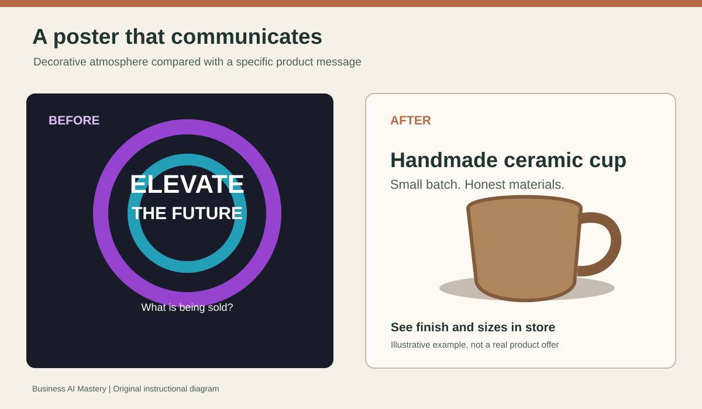

# A fashion label: identity and collection visuals

> This is a **fictional teaching case**, not an account of actual customer transactions, staff or businesses. Replace example values and claims with verified material before any real use.



## Fictional brief

A small label is releasing a limited run of shirts with verified fabric composition, sizes and care instructions. The maker wants a visual story that reflects the actual work rather than generic glossy models.

### The visual bible

Record the authentic fabric, stitching, fit reference, garment dimensions, approved colour names and permitted model photographs. A generated image may inspire art direction, but it must not change the garment silhouette or imply that a fictional person endorses it.

### Prompt sequence

```text
Act as a fashion editor preparing a photographic shot list. We have a real shirt, a shop wall, a window, a hanger and a consenting person for a fit photo. Propose five frames that each reveal a different feature: complete front, cloth texture, seam detail, real fit and care information. No fictitious location or material claim.
```

### Production

Photograph the real item first. Use an image tool for moodboard experiments only when necessary. In Canva, make a lookbook spread with one photograph per visual purpose. In the video editor, cut together movement that shows how the material falls. Narration may explain care or sizing, but every specification must match the actual label.

### Bad versus better

**Bad:** “Elevate your everyday luxury with iconic, revolutionary style.” **Better:** “A light cotton shirt with a relaxed cut. Compare the measurements before choosing your size.” The latter is only acceptable if those attributes are confirmed.

**Result to measure:** Size questions answered before purchase and fewer avoidable returns.

## Questions to discuss after the exercise

1. Do model photographs and measurements represent the garments actually sold?
2. Is the person in the fit photograph authorised for this use?
3. Which line of copy implies a fabric or care property not verified?
4. What return reason would signal a problem with the size guide?

[Return to the index](../README.md)

## Extended case: a collection that looks like the actual clothes

The fictional clothing brand photographs three shirts in a single afternoon. The first output is a customer information page, because size and fabric details affect returns. The second is a restrained lookbook. The third is a short motion study showing how cloth behaves on a consenting model. The same approved colour names, sizes and care instructions must flow through all three.

### Build the source pack

Include front and back photographs, flat measurements with a definition of how they were taken, fabric composition from a verified label, garment fit notes and the model's permission for the specified uses. Define what is unknown: shrinkage, durability and any unsupported claims about sourcing. Never invent a 'handmade' or sustainability story to make the description sound more thoughtful.

```text
Write a size guide from this measured garment table only. Explain how
someone should compare the measurements to a shirt they already own.
Do not convert garment measurements into guaranteed body sizes. Flag
any missing dimension and any inconsistency between the table and
photographs. Keep the tone informative and calm.
```

### Creative treatment

A strong visual direction could be cream walls, real daylight and close observations of stitching and fabric. A weak treatment might cover the product in chrome reflections, add invented folds and put a garment on a fictional model whose proportions are not truthful. A good editorial image helps the buyer notice features; it does not promise the garment will look identical on every person.

**Storyboard:** shot 1 shows the front silhouette, shot 2 moves to seam detail, shot 3 shows an actual model turning naturally, shot 4 includes accurate sizing guidance. Use a caption such as *Compare the chest measurement with a shirt you own*, if the measurements and instructions are correct.

### Editorial comparison

Weak: *Timeless, iconic luxury for visionaries.* Better: *The relaxed cut gives the shirt room through the shoulders. Check the measured chest and length before choosing a size.* The latter requires confirmation from the garment and measurement guide.

### Measure

Record customer size questions, product page exits, conversion and returns with reasons when available. Look for recurring sizing confusion rather than celebrating views alone. A useful result may be fewer avoidable returns, even if a very glossy campaign would attract more casual likes.
