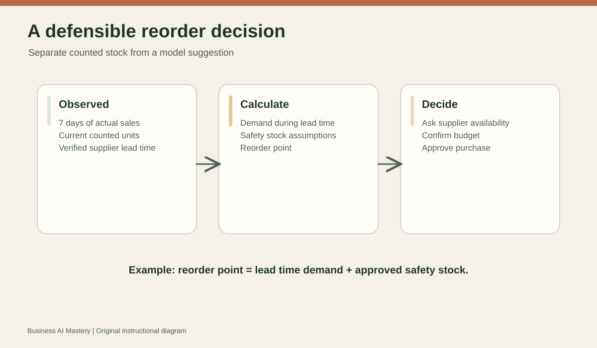

# An online shop: listings and aftercare

> This is a **fictional teaching case**, not an account of actual customer transactions, staff or businesses. Replace example values and claims with verified material before any real use.



## Fictional brief

A small ecommerce store has six colour variants of a product, several different shipping regions and an actual returns policy. Its owner wants clear product pages and consistent aftercare responses.

### Source structure

Use one authorised product table with variant IDs, approved images, size, material, price and inventory. Keep delivery rules and returns policy separate because they may change independently. Every listing should identify the date and source of facts.

```text
For product SAMPLE-22, create a draft listing using only its current catalog record. Include an honest title, short description, measured dimensions, care notes and a question customers commonly ask. Do not infer inventory from photography. Do not invent delivery promises or warranty terms.
```

### Publishing sequence

Check the correct variant for each photo, review the draft against the actual product, inspect mobile layout and obtain approval. A store assistant may help identify missing fields but should not silently change prices or stock. Record who approved the final page.

### Customer support

Use the store's actual policy to answer order questions. A customer who ordered the wrong size needs a policy based explanation, not a generic “we guarantee satisfaction” reply.

**Result to measure:** Fewer inaccurate listings, fewer unnecessary support tickets and less time spent correcting published information.

## Questions to discuss after the exercise

1. Does every SKU map to the correct photograph and colour?
2. Which delivery rule changes by region?
3. What information should be withheld from public support examples?
4. How can variant returns signal an inaccurate listing?

[Return to the index](../README.md)

## Extended case: catalogue integrity across six variants

A fictional online shop sells a plain ceramic jar in six colours. Customer complaints reveal that some images show the wrong lid colour. The first priority is correcting catalogue accuracy. A model can help audit the data and draft product descriptions, but it should not invent the missing images.

### Variant audit

Create a source table mapping SKU, colour name, material, capacity, lid, verified photograph, current price and stock status. Each image needs a file name and confirmed relationship to a variant. Ask a model to identify gaps and duplicates before generating copy.

```text
Check this six-variant catalogue. Flag any image file shared across
variants that have visibly different colours, duplicate SKUs, blank
capacities and conflicting size units. Produce an internal repair list,
not public customer copy. Do not infer a lid colour from a variant name
or create a substitute product image.
```

### Product page revisions

A strong page has a precise title, verified dimensions, relevant care instructions, accurate availability and clear shipping conditions. Use the genuine product image as the primary source. A generated lifestyle background can support a campaign concept only if it does not alter what buyers will receive.

**Poor copy:** *The ultimate jar for all your needs.* **More informative:** *This 700 ml jar has the screw-top lid shown in the photographs. Check the dimensions before placing it on a narrow shelf.* Confirm both details in the product record.

### Aftercare

Link the real returns policy rather than prompting the support assistant to invent a friendly resolution. If an order is damaged, ask only for the next information the approved process needs. Do not send a refund until the authorised person or system completes the appropriate review.

### Evaluate

Count listing corrections, customer questions about variants, returns due to mismatched photos and time spent updating the catalogue. The goal is fewer misleading pages and better buying decisions, not the longest possible product descriptions.
