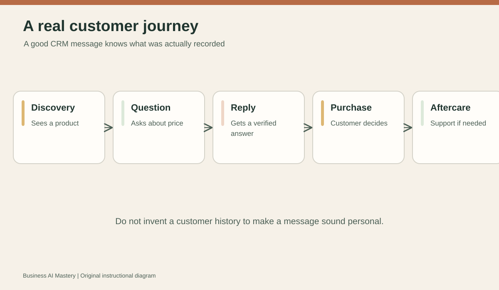

# A restaurant: service, menu and customer questions

> This is a **fictional teaching case**, not an account of actual customer transactions, staff or businesses. Replace example values and claims with verified material before any real use.



## Fictional brief

A small restaurant has a verified seasonal menu and receives many questions about opening hours, dietary ingredients and group bookings. This exercise uses invented business details and must not be copied as a real restaurant offer.

### Build the truth set

The manager writes an approved menu spreadsheet with item names, ingredients as confirmed by kitchen staff, prices, availability rules and the date reviewed. A separate policy explains reservation requests and deposits. Do not use a generated ingredient list as a source for allergy information.

### Prompt sequence

```text
Using only the approved menu and booking policy, group these anonymised customer questions into menu, hours, group bookings and questions requiring kitchen confirmation. Draft a short FAQ. For any allergy or ingredient question not proved by the current source, say that a staff member must confirm it.
```

A useful answer says which facts are recorded and which need the kitchen. A dangerous answer invents a guarantee that a meal is safe for a particular allergy.

### Content campaign

Film an actual dish preparation with permission, showing ingredients truthfully. Create a short reel with natural sound and legible captions. A menu poster should use actual food photographs when available, with price and availability checked on the day of publication.

### Human review

The chef checks ingredient claims. The manager reviews operating hours and booking terms. The team answers new questions and adds only verified information to the knowledge base.

**Result to measure:** Fewer repeated questions and a higher proportion of enquiries resolved accurately.

## Questions to discuss after the exercise

1. Which ingredients are confirmed by the kitchen and which are unknown?
2. Would a photograph or caption imply an ingredient absent from the dish?
3. Who can approve allergy and booking statements?
4. How will the team know the FAQ actually reduces repeated questions?

[Return to the index](../README.md)

## Extended case: the lunch menu launch

**Teaching assumptions.** The fictional restaurant has six approved lunch items. A temporary menu spreadsheet says which items are offered on Friday. A photograph folder contains genuine images of three of the items. No price, ingredient or allergen information should be inferred from how food looks. For this exercise, the manager has confirmed an opening time of 11 a.m., but has not confirmed whether walk-in group tables are available.

### A three-hour production plan

**First 30 minutes:** The kitchen lead signs off the name, ingredients, portions and availability of the three photographed dishes. Any allergen questions that cannot be answered reliably go into a human-handled enquiry list. **Next 30 minutes:** A writer drafts short descriptions answering what the food is, not whether it will 'change your life'. **Next 45 minutes:** Capture or select actual food photographs, record ambient preparation footage and build one poster. **Next 45 minutes:** Assemble a 20-second Reel using genuine action, legible captions and the approved menu information. **Final 30 minutes:** The manager checks prices, hours, pronunciation and the call to action before publishing.

### Working prompts

```text
From the approved Friday lunch sheet, write three menu explanations.
For each dish, state only the listed main ingredients and preparation
style. Keep one sentence per item. Any uncertainty about allergens or
cross-contact must be marked for kitchen confirmation; do not assert
that a dish is safe for a medical dietary need.
```

```text
Plan a 20-second video from these real clips: kitchen preparation,
plating and the finished dish. Use a four-shot sequence with time codes,
what the shot shows and one truthful caption per shot. Keep the kitchen
sounds audible. Do not invent a chef quotation, a customer reaction or
a price we have not approved.
```

### What can go wrong?

A generated image may add ingredients absent from the meal. A transcription tool may transform the name of a local dish into an unrelated English word. A stylish poster may hide the opening time under platform controls. A customer support assistant may promise group booking space despite the policy being unresolved. Each error has a specific repair: use real photography, correct the actual caption, reposition text and route unanswered booking questions to a person.

### Assess results

Track menu enquiries, actual orders of promoted dishes and corrections to published details. Do not claim that a spike in sales was caused by the campaign alone, especially if weather, nearby events or availability changed. The learning goal is to create accurate useful material with fewer staff corrections.
