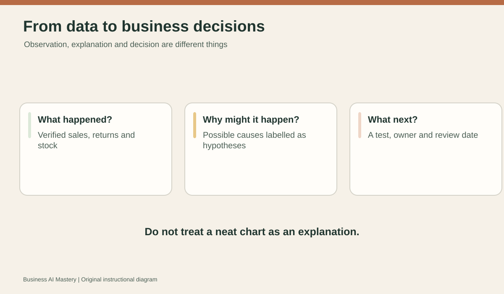

# A small retail shop: weekly operations

> This is a **fictional teaching case**, not an account of actual customer transactions, staff or businesses. Replace example values and claims with verified material before any real use.



## Fictional brief

A general retail shop needs to understand declining sales in one category and decide what to check before buying more stock. The owner has a daily sales export, actual counted inventory and a record of supplier lead times. The business does **not** have verified purchase cost information in this exercise.

### Sample input

| Product | Units in week A | Units in week B | Stock counted |
| --- | ---: | ---: | ---: |
| Notebook | 42 | 30 | 18 |
| Pen | 85 | 91 | 66 |
| Folder | 24 | 11 | 27 |

The notebook fell 12 units, a decrease of approximately 28.6 percent. Folder units fell by 13, approximately 54.2 percent. These numbers alone cannot explain why.

### Prompt sequence

```text
From this fictional table, calculate absolute and percentage change by product. Verify the arithmetic and keep the stock count as a separate measure. Then give at least two plausible explanations for each change, labelled hypotheses, and the evidence that would test them. Do not estimate profit.
```

### Better management response

The owner asks the stock controller to check whether folders were visible, priced correctly and available throughout the reporting week. Only then does the team choose whether to reorder, change display or collect more data. The action is based on a specific uncertainty, not a broad claim that advertising is needed.

### Content handoff

If the shop decides to demonstrate folder sizes, photograph the actual sizes, add a confirmed price only after approval, and use Canva for a clean graphic. Keep recorded customer questions as the source for the headline.

**Result to measure:** Fewer stock surprises and useful customer enquiries, not the number of generated reports.

## Questions to discuss after the exercise

1. Did a slow-moving item have available stock throughout the review period?
2. Which margin or stock count is missing before a proposed discount?
3. What can the product photograph prove without invented decoration?
4. What recorded change would justify repeating the campaign?

[Return to the index](../README.md)

## Extended case: a weekly stock decision becomes one useful campaign

In the fictional shop, three items sold steadily last month while two have been on the shelf for weeks. The owner wants more cash available for new purchases. It would be tempting to ask a model which products to discount. That skips supplier costs, actual stock counts and restrictions on price changes.

### Start with a reconciliation

Count stock physically, compare expected closing stock to actual quantity and note stockouts. Supply item codes, receipts, returns and current prices. Ask for the slow-moving items using a stated definition, such as items with no recorded sales in 30 days while verified stock was available. Do not define slow movement by guesswork.

```text
Using the fictional stock and sales tables, find items with no sales in
the last 30 days *and* a positive verified stock balance throughout
that period. Show the source fields and list data gaps. Do not propose
a discount until the owner confirms costs, margin and cash priorities.
```

### Content after the decision

Once the owner approves a truthful offer, choose one item, photograph it and explain the practical benefit. For example, a storage container poster could show an actual measured capacity beside a familiar object. Avoid generic 'big sale' promises if there is no approved reduction. A phone video might show a worker opening and closing the actual lid, with natural sound and concise text.

### Human edit

Before: *Transform your storage with our revolutionary home solutions.* After, if verified: *This container holds 2 litres and fits on the middle kitchen shelf shown here. Visit the counter to see the lid seal.* The second tells customers something they can check. Keep the promotional material tied to the approved catalogue and price list.

### Measure

Report quantities sold and remaining stock, cash collected and customer questions, with dates. Separate turnover from profit and record any price changes during the period. A quiet but accurate campaign may outperform visually spectacular content when customers are ready to purchase.
