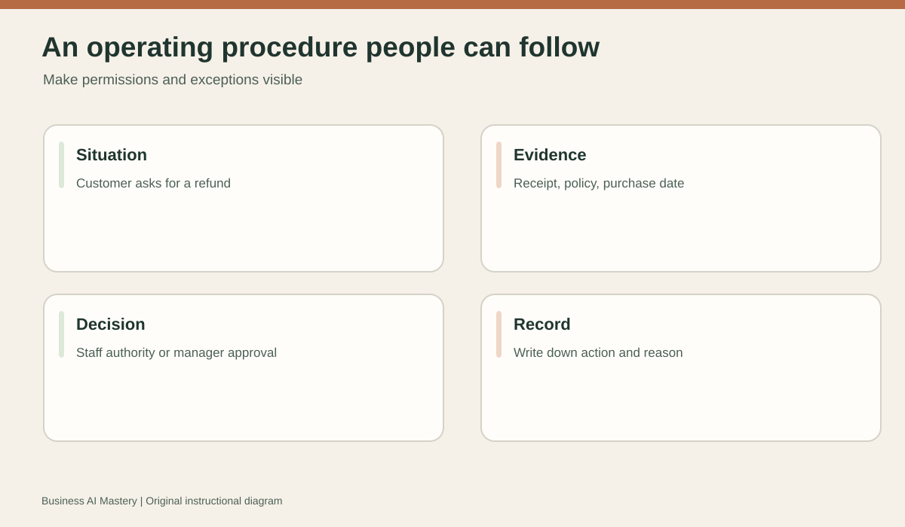

# A local service company: explaining a process

> This is a **fictional teaching case**, not an account of actual customer transactions, staff or businesses. Replace example values and claims with verified material before any real use.



## Fictional brief

A repair service receives questions about booking, inspection, pricing and collection. Staff want a clear explanation without promising outcomes before a technician has inspected the item.

### Start with operations

Write a source document stating which services are offered, how an inspection request is logged, what can be quoted in advance, and who may approve an estimate. Include exceptional cases, such as unrepairable items or delayed parts.

```text
From this approved service procedure, create a plain language customer explanation in five short stages. Keep inspection and repair separate. Do not promise a final price, timing or guaranteed result unless the source confirms it. Add a checklist of information needed to begin the enquiry.
```

### Turn the explanation into media

Use a simple process diagram, genuine location photographs and a short video of staff explaining what happens at intake. The video should demonstrate normal steps, not imply that a particular repair was completed if the footage is illustrative.

### Humanisation

Remove phrases like “world class, seamless service” and say who will inspect the item, what the customer should bring and when they can expect an update only if those details are approved. Real service language reduces uncertainty.

### Review

An experienced technician checks the process. A front desk employee checks that the wording answers actual questions. If the team disagrees, amend the process before polishing the wording.

**Result to measure:** Fewer repeat enquiries about the process and fewer misunderstandings at intake.

## Questions to discuss after the exercise

1. Which service steps are confirmed and which require a technician?
2. Does the copy promise a fee or timetable not approved by the company?
3. How would a customer understand the quote and approval process?
4. What recurring enquiry reveals that the explanation is still unclear?

[Return to the index](../README.md)

## Extended case: explaining a service before selling it

A fictional home appliance repair business receives repeated questions about booking, call-out charges and whether the technician can fix every fault on the first visit. The business wants fewer misunderstandings, not merely more messages. Write the actual service process with authorised staff before generating any copy.

### Canonical procedure

List the steps from enquiry to inspection, quote, approval, work, test and invoice. Mark fees that are conditional, geographical areas served, appointment times, parts availability and who may change the quote. If the process has not been documented, the first job is to interview staff and approve a procedure.

```text
Using this signed service policy only, write a one-page explanation of
how a customer books a repair. Include booking information, what happens
on arrival, when a quote is provided, what the customer approves, and
what cannot be guaranteed before inspection. No invented 'same-day'
promise, no success rate and no fabricated staff expertise.
```

### Explain visually

A short reel can show a genuine technician checking an appliance, but it should not pretend that a fictional generated repair solved a customer's real problem. Use real process footage and blur private details. A simple on-screen sequence such as *Describe the fault, book an inspection, review the quote* can be more valuable than dramatic tool sparks or impossible mechanical transformations.

### Humanise the service explanation

Weak: *We deliver world-class, seamless customer satisfaction across every touchpoint.* Better: *Tell us the appliance model and what it is doing. We will explain the inspection process before you decide whether to book.* The latter is acceptable only if it reflects policy. Real trust comes from saying what happens next and what remains uncertain.

### Assess results

Measure how many initial enquiries contain the information staff need, how frequently prices are disputed, how long booking confirmation takes and whether customers understand approval before repair. A reduction in confusion can be more useful than an increase in impressions.
