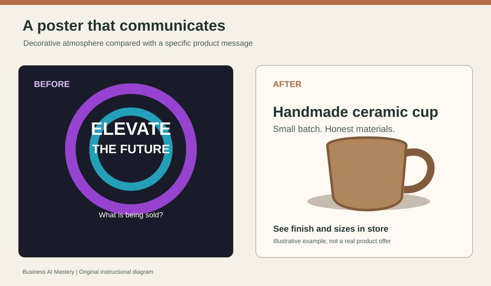

# Common mistakes and realistic repairs

## Failure patterns in the expanded handbook

### The actual problem behind familiar outputs

People often receive similar looking content because they ask for the same broad words: “premium”, “modern”, “cinematic”, “viral”, “professional”. Generators fill in the missing choices using familiar patterns. Creative marketplaces also encourage copying whatever currently gets clicks. The result can be a flood of blue and purple glows, black metallic surfaces, geometric rings, floating symbols, dramatic lens flare, perfectly smooth skin and shouting headlines. These are not universal signs that a particular asset was generated. They are signs that the art direction has been left to a template.

A strong brief does not say merely “no neon”. It names what belongs in the scene: the actual object's dimensions, the available light, real materials, useful cropping and a purpose for the image. If the real location has chipped paint and morning window light, those details offer more identity than another universal gradient. The real customer's question often provides a better headline than a list of superlatives.

### Text flags and why they fail

Watch for openings that say nothing about the situation: “In today's changing world”, “Unlock the future”, “Transform your journey”. Look for claims without a source, repeated claims expressed as three synonyms, paragraphs of identical length, forced transitions, generic praise and endings that say only “Take the next step”. Ask who is speaking, what they know, and what question they are answering. Make the first sentence useful.

### Image flags and why they fail

Check too perfect reflections, skin without texture, nonsensical product labels, changing hardware, impossible shadows, decorative objects that add nothing, random symmetry, identical camera distance across a campaign, and contrast so aggressive that text becomes unreadable. Correct physical truth before polishing colour. A visible product photograph often matters more than a stylish background.

### Video and sound flags

Generated movement may create hand changes, objects that melt between frames, unnatural acceleration, drifting faces, unstable text and cuts with no narrative reason. Synthetic narration can sound too smooth, push emotional stress into irrelevant words or mispronounce names. Treat those as editing defects to fix with stronger source footage, shorter shots, slower timing, clear phonetics or a real recorded voice.

### The humanisation process

Humanising a draft means bringing it closer to a particular reader's actual situation and to facts that can be supported. It does not mean hiding required disclosure, impersonating a real person, fabricating a review or pretending synthetic media documents an event. Edit in this order: truth, relevance, angle, rhythm, visual restraint, usefulness, final sign off. A specific, modest statement is often more persuasive than a dramatic promise.

> Weak: “Experience a game changing collection designed to elevate every moment.” Better: “Hold the three cups in store and compare their handles before choosing.” The revised line is useful only if the business genuinely permits in store comparison.

## Editorial warning signs from the first field guide

These are editorial warning signs, not a universal blacklist. Some
phrases are perfectly suitable in the right context. Remove them when
they add no meaning or make the work sound generic.

## A. Common wording problems

  -----------------------------------------------------------------------
  AI habit                Why it can be weak      Better editorial action
  ----------------------- ----------------------- -----------------------
  "In today's fast-paced  Generic opening         Start with the actual
  world"                                          issue

  "Unlock your potential" Overused promise        State the real benefit

  "Revolutionary"         Often unsupported       Describe what is
                                                  genuinely different

  "Seamless experience"   Vague                   Explain what becomes
                                                  easier

  "Game changer"          Inflated language       Explain the practical
                                                  improvement

  "Whether you're a       Broad filler            Name the actual
  beginner or expert"                             intended audience

  "It's important to note Often unnecessary       State the point
  that"                                           directly

  "In conclusion"         Can feel formulaic      End with the practical
                                                  takeaway

  "Furthermore" in every  Repetitive transitions  Use natural connections
  paragraph                                       or none

  "Delve into"            Often stiff in casual   Use "look at",
                          writing                 "explore" or a precise
                                                  verb

  "Harness the power of"  Vague promotional       Say what the tool does
                          language                

  "Elevate your..."       Often empty marketing   Explain the improvement
                          language                

  "At the end of the day" Can be filler           State the conclusion

  "In a world where..."   Broad and predictable   Open with a concrete
                                                  observation
  -----------------------------------------------------------------------

Do not ban a word simply because AI sometimes uses it. Judge whether it
is useful in that sentence.

## B. Structural habits to review

-   Every response starting with a grand introductory paragraph.
-   Repeated headings that say almost the same thing.
-   Too many bullet lists for simple ideas.
-   Every paragraph having identical length.
-   Repeating the same point in the introduction, body and conclusion.
-   Forced "three reasons" or "five benefits" structures.
-   Unnecessary summaries after a short piece of writing.
-   Overuse of bold text and capital letters.
-   Excessive emojis, hashtags and exclamation marks.
-   Repetitive calls to action.
-   Artificially balanced sentences that do not sound like the brand.

## C. Visual and design problems to review

-   Too many gradients, glows, shadows and decorative effects.
-   Random icons that do not communicate anything.
-   Tiny text and crowded layouts.
-   Too many fonts or inconsistent spacing.
-   Fake logos, misspelled brand names and distorted text.
-   Unrealistic product proportions or incorrect product details.
-   Plastic-looking faces and strange hands in generated images.
-   Backgrounds that compete with the main subject.
-   Fake badges such as "No. 1" without evidence.
-   Stock-looking images that do not relate to the actual audience.
-   Excessive visual effects that reduce readability.

## D. Video and audio problems to review

-   Generic AI voices that do not suit the subject.
-   Unnatural pauses or incorrect pronunciation.
-   Music that is louder than the speaker.
-   Captions that do not match the spoken words.
-   Random transitions and unnecessary zooms.
-   Repeated stock footage.
-   Overly polished scenes that look unrelated to the real business.
-   Synthetic people presented as real customers or staff.
-   Fake testimonials, fabricated interviews or invented endorsements.

## E. Never remove transparency or evidence to make content look human

Do not remove required AI disclosures, ownership information, source
attribution, content credentials or legally required notices just to
make content appear human-made. Do not fabricate a personal story,
customer quote or review. Humanisation should improve authenticity, not
manufacture it.

------------------------------------------------------------------------

## An editor’s diagnostic order

A factual error takes priority over style. A misleading scene takes priority over colour. A missing reader question takes priority over the number of transitions. A wrong name or price is never repaired by stronger type or a prettier background.

Do not describe these flags as proof that a piece was generated by a model. They diagnose weak editorial decisions, not authorship.

## Clinic: why attractive content can still be weak

**1. The purple-and-cyan technology poster.** The brief says *modern, powerful, futuristic*. The generator chooses a familiar glowing gradient and a floating object. The repair is to specify the customer's actual environment, one relevant product detail, real lighting direction, neutral background and a clear text area. Do not ban neon universally; use it only when the brand and message warrant it.

**2. An invented five-star badge.** A template or image model places *No. 1* or five stars on a poster. The problem is not typography, it is an unsupported claim. Remove it unless the exact rating and its source are verified and permitted to be used.

**3. A fake perfect customer.** A generated portrait is presented as a testimonial. Replace it with a real, consenting customer account or an explicitly fictional illustrative scenario. Never fabricate endorsements.

**4. The image looks right until you inspect the product.** Labels, handles, buttons or fabric change between versions. Use genuine photography for commercial identity and separate it from generated backgrounds.

**5. Every video shot is a dramatic reveal.** There is no actual demonstration. Keep a visual storyline with an object, an action, evidence and a next step; reserve atmosphere for a small portion of the edit.

**6. The voice speaks like a promotional machine.** Every sentence rises in pitch and contains the same triumphant emphasis. Rewrite the script for normal speech, choose a more fitting voice and keep meaningful pauses.

**7. Charts have no source or denominator.** A report says customer engagement rose 45% but never defines engagement. Return to the original export, time period, denominator and calculation.

**8. An automation answers outside policy.** The draft is eloquent but promises an unapproved refund. Add current policy retrieval, explicit uncertainty handling and human approval. Test adversarial messages.

**9. Local flavour feels theatrical.** Adding random slang, landmarks or dialect does not create genuine relevance. Use the audience's actual language where supported by approved material and real conversations.

**10. A brand looks identical to every other brand.** Repeatable template grids, stock images and generic slogans cause sameness. Build an identity from the business's real product, material, place, customer questions and visual decisions. A viewer should recognise the organisation even without a logo.

For each failure, record: **what failed, what source proves it failed, one repair, and how the revised output will be tested**. The goal is not making material undetectable as generated, but making it truthful, useful and worthy of publication.
