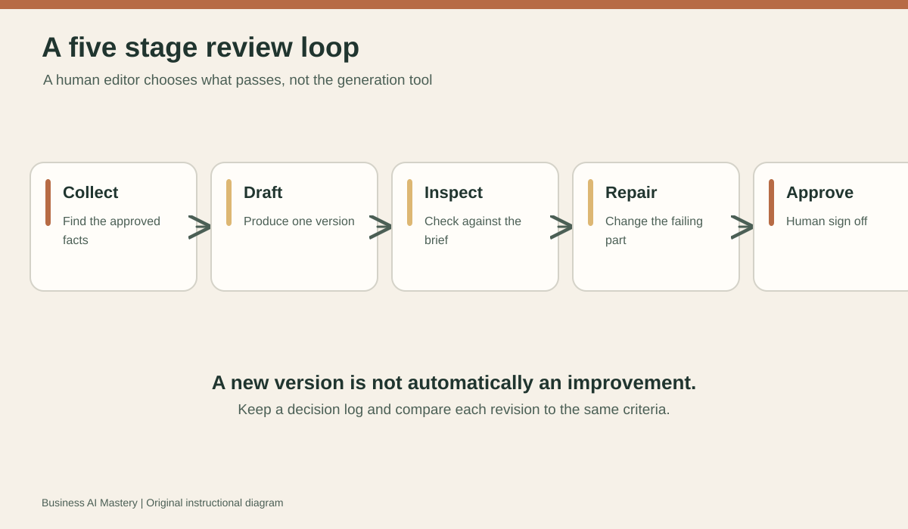

# Quality assurance and publishing checks

## Core quality checks

### Check the text

Does the opening address an actual question? Are claims supported? Is the speaker identifiable? Are units, names, dates and prices accurate? Does the text fit the format? Have words been repeated because they sounded impressive rather than because the reader needs them?

### Check the visuals

Is there a clear focal point? Are the real product, person or location depicted truthfully? Do anatomy, light, reflection and scale agree? Are there invented labels or marks? Is the type readable at normal size? Does every effect have a reason to exist?

### Check motion and sound

Do objects persist between frames? Is the camera motion motivated? Is a spoken name pronounced correctly? Does music mask the words? Are automatic captions accurate? Can the story be understood both with sound and with ordinary visual attention?

### Check the project itself

Can another person find the approved facts, source files, editable masters, licence records and final exports? Is the latest approved version obvious? Does the client know which content is fictional, illustrative, generated or recorded? Are platform disclosures made when applicable?

The last test is simple: would a knowledgeable member of the intended audience trust the result once they understood how it was made? Work that survives that question usually owes its quality to careful human choices, not the novelty of the rendering tool.

## Original field guide review exercises

A portfolio demonstrates what you can actually produce. It is more
convincing than listing many tools without examples.

## Suggested portfolio projects

### Project 1: Product campaign

-   Poster
-   Three captions
-   Short product video
-   Carousel
-   Content calendar

### Project 2: Educational campaign

-   Research notes and sources
-   Explainer article
-   Five-slide carousel
-   Short narrated video
-   Infographic

### Project 3: Personal brand campaign

-   Brand voice guide
-   Profile introduction
-   Professional post
-   Short video
-   Presentation

### Project 4: Event campaign

-   Event poster
-   Announcement caption
-   Countdown graphics
-   Short promotional video
-   Event recap template

Use fictional businesses for practice or obtain permission to work with
a real organisation. Clearly identify concept work as a portfolio
concept, not a real client commission.

## Universal pre-publication checklist

### Message

-   [ ] Is the purpose clear?
-   [ ] Is the main message obvious?
-   [ ] Is the audience correctly identified?
-   [ ] Is the call to action useful?

### Accuracy

-   [ ] Are names and dates correct?
-   [ ] Are prices and specifications confirmed?
-   [ ] Are statistics sourced?
-   [ ] Are quotes genuine and attributed?
-   [ ] Are assumptions clearly marked?

### Human quality

-   [ ] Does the writing sound natural when read aloud?
-   [ ] Are there specific details rather than empty claims?
-   [ ] Have repeated ideas been removed?
-   [ ] Does the tone fit the brand?
-   [ ] Is the content genuinely useful?

### Visual and audio quality

-   [ ] Is the layout readable on a phone?
-   [ ] Are images accurate and appropriate?
-   [ ] Are captions correct?
-   [ ] Is the audio balanced?
-   [ ] Are the logo and brand assets correct?

### Rights and safety

-   [ ] Are asset licences appropriate?
-   [ ] Is consent available where needed?
-   [ ] Is private information protected?
-   [ ] Is AI disclosure required?
-   [ ] Are all platform rules checked?

### Delivery

-   [ ] Is the export format correct?
-   [ ] Is the file named clearly?
-   [ ] Is the editable source saved?
-   [ ] Is the approved final version archived?

------------------------------------------------------------------------
## Owner approval record

Before a business publishes or sends anything, confirm the identity of the business, its approved claims, all prices and time conditions, contact details, the accuracy of product appearance, the rights to use footage and music, consent from identifiable people, the spelling of names, the correctness of captions and the intended destination. If an assistant will act through another application, inspect its permissions and require explicit approval for payments, refunds, account access, publishing and external messages.

For a report, trace each numeric statement to the original file. For a CRM message, trace the personal reference to an actual logged interaction. For a product image, compare it to the physical item. For a video, watch at normal speed and inspect critical frames. For narration, listen for natural meaning and correct pronunciation. An attractive result is not evidence of a correct result.

## Simple approval table

| Asset | Verified facts | Permission and rights | Accessibility | Final owner | Status |
| --- | --- | --- | --- | --- | --- |
| Example poster | Pending | Pending | Pending | Business owner | Draft |
| Example narrated reel | Pending | Pending | Pending | Marketing lead | Draft |

A checklist becomes useful when the names and evidence are filled in.

## Stop-the-line failures

Any one of the following should block publication regardless of an overall quality score: an invented price, false safety or warranty statement, fabricated testimonial, unauthorised use of a person's image or voice, undisclosed realistic synthetic event where the platform requires disclosure, private customer information shown publicly, an inaccessible vital instruction or a material mistake in a financial figure.

### Image review on an ordinary phone

Check the exact product, number of components, label, scale, lighting direction, skin or hand details, contact shadow, reading order, headline crop, text size and approved logos. Zoom out until the image matches its expected display size. A flawless close-up that is unreadable in the feed is not finished.

### Narration and video review in three modes

Watch silently: can the viewer understand the action and the product? Listen without the screen: can the listener follow the spoken argument and hear every key term? Watch with captions and interface overlays: are words accurate, synchronised and visible? Repeat on the exported file, not just the editor's preview.

### Management report evidence check

Verify period and currency, input grain, missing fields, reconciliations, all major totals, distinction between descriptive observations and proposed explanations, confidentiality controls and the employee who will approve decisions. Use the [evaluation scorecards](evaluation-scorecards.md) for an auditable rubric rather than a vague 'looks professional' judgement.
