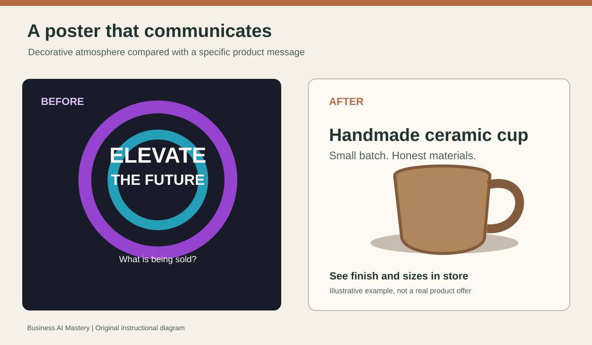
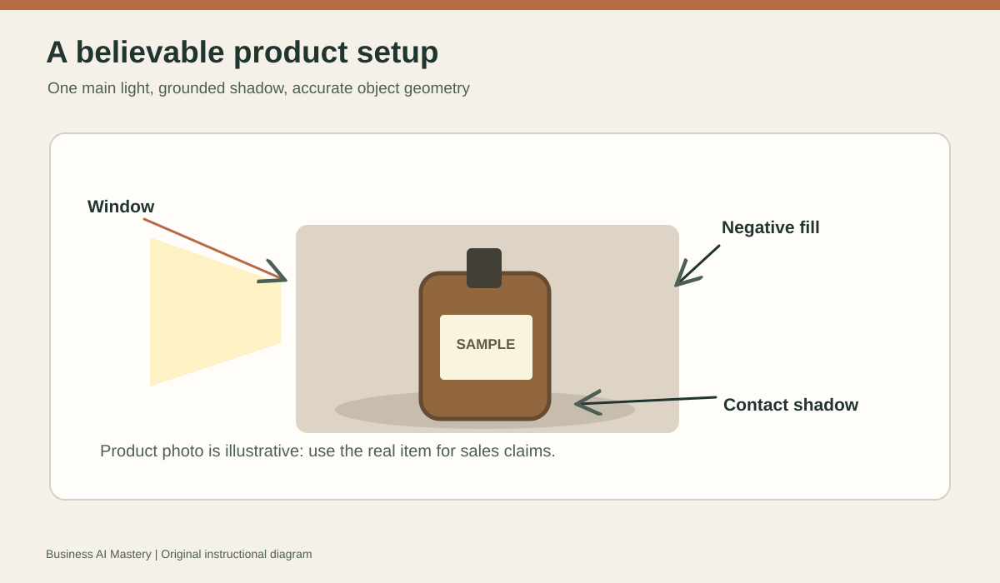
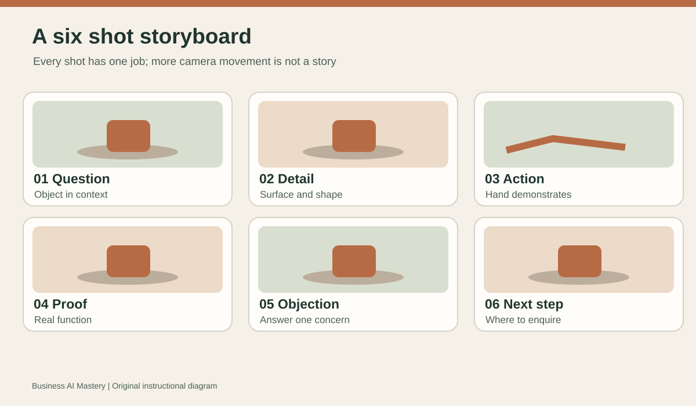

# Business AI Mastery

**A public, illustrated course for using models and business applications in management, operations and creative production.**  
*Editorial edition: 20 November 2026. English. Free to read and adapt with attribution.*

A useful business assistant should help you make a better decision, produce an accurate asset or save time on work someone can verify. It should not invent customer experiences, change financial figures, hide the limitations of a product or replace an approval process. This course teaches the working method rather than celebrating the software.

**Begin here:** [START HERE](START-HERE.md) | [Choose the right tool](06-reference/model-comparisons.md) | [Prompt library](06-reference/prompt-library.md) | [Source register](06-reference/sources-and-updates.md)

## Choose your learning path

| I want to... | Read first | Practise next |
| --- | --- | --- |
| Understand prompting | [Prompting fundamentals](01-foundations/prompting-fundamentals.md) | [Advanced prompting](01-foundations/advanced-prompting.md) |
| Keep project context accurate | [Context engineering](01-foundations/context-engineering.md) | [Working with files](01-foundations/working-with-files.md) |
| Run better operations | [Business strategy](01-foundations/business-ai-strategy.md) | [Weekly reporting](04-practical-workflows/business-reporting.md) |
| Create authentic content | [Humanisation](01-foundations/humanization.md) | [Visual design](01-foundations/visual-design-principles.md) |
| Make video and voice | [Multimodal content](01-foundations/multimodal-content.md) | [Narrated video](04-practical-workflows/video-and-voice.md) |
| Avoid generic output | [Why outputs look alike](01-foundations/avoiding-generic-content.md) | [Repair clinic](06-reference/common-mistakes.md) |
| Build a complete campaign | [Marketing workflow](04-practical-workflows/marketing-campaigns.md) | [Full campaign](05-real-world-examples/complete-campaign.md) |

## Foundations

1. [Understanding AI in an actual business](01-foundations/understanding-ai.md)
2. [Models, applications and subscriptions](01-foundations/how-models-work.md)
3. [Prompting fundamentals](01-foundations/prompting-fundamentals.md)
4. [Advanced prompting and revision](01-foundations/advanced-prompting.md)
5. [Context engineering for long projects](01-foundations/context-engineering.md)
6. [Working with spreadsheets, documents and images](01-foundations/working-with-files.md)
7. [One story across text, images, voice and video](01-foundations/multimodal-content.md)
8. [Humanisation as editorial judgement](01-foundations/humanization.md)
9. [Why generic generated content looks the same](01-foundations/avoiding-generic-content.md)
10. [Visual design, composition and useful restraint](01-foundations/visual-design-principles.md)
11. [Accuracy, privacy, rights and disclosure](01-foundations/verifying-results.md)
12. [Choosing tools by business need](01-foundations/business-ai-strategy.md)
13. [Rights, disclosure and provenance](01-foundations/rights-disclosure-and-provenance.md)
14. [Accessibility for all formats](01-foundations/accessibility-for-every-format.md)
15. [Brand voice and visual systems](01-foundations/brand-voice-and-visual-systems.md)
16. [Camera, lighting and visual language](01-foundations/camera-lighting-and-visual-language.md)
17. [Research and source literacy](01-foundations/research-and-source-literacy.md)

## Business management and operations

1. [ChatGPT: GPT 6.2 Astra and Sol](02-business-management/chatgpt.md)
2. [Claude: Opus 5.5 and Sonnet 5.5](02-business-management/claude.md)
3. [Google Gemini for business](02-business-management/gemini.md)
4. [Microsoft 365 Copilot](02-business-management/microsoft-copilot.md)
5. [Perplexity](02-business-management/perplexity.md)
6. [Notion AI and Notion Agent](02-business-management/notion-ai.md)
7. [ClickUp Brain](02-business-management/clickup-brain.md)
8. [HubSpot Breeze](02-business-management/hubspot-breeze.md)
9. [QuickBooks with Intuit AI](02-business-management/quickbooks.md)
10. [AI by Zapier and former Zapier Agents](02-business-management/zapier-agents.md)
11. [Shopify Sidekick](02-business-management/shopify-sidekick.md)
12. [Intercom Fin](02-business-management/intercom-fin.md)
13. [Gemini Notebook for source research](02-business-management/gemini-notebook.md)

## Content creation and publishing

1. [Canva Magic Studio](03-content-creation/canva.md)
2. [GPT Image 2.6](03-content-creation/gpt-image.md)
3. [Adobe Firefly](03-content-creation/adobe-firefly.md)
4. [Ideogram 4.6](03-content-creation/ideogram.md)
5. [Google Nano Banana](03-content-creation/nano-banana.md)
6. [Midjourney](03-content-creation/midjourney.md)
7. [Runway Gen 4.5 and Aleph](03-content-creation/runway.md)
8. [Google Veo and Gemini Omni](03-content-creation/veo-and-gemini-omni.md)
9. [Kling video generation](03-content-creation/kling.md)
10. [ElevenLabs voice](03-content-creation/elevenlabs.md)
11. [CapCut video editing](03-content-creation/capcut.md)
12. [DaVinci Resolve](03-content-creation/davinci-resolve.md)
13. [Adobe Premiere Pro](03-content-creation/premiere-pro.md)
14. [Buffer scheduling and editing](03-content-creation/buffer.md)
15. [Meta Business Suite](03-content-creation/meta-business-suite.md)
16. [Adobe Express for editable design](03-content-creation/adobe-express.md)
17. [Adobe Podcast for recorded voice](03-content-creation/adobe-podcast.md)
18. [Audacity for sound cleanup](03-content-creation/audacity.md)
19. [Gamma for presentations](03-content-creation/gamma.md)
20. [Metricool for content analytics](03-content-creation/metricool.md)

## Practical workflows

1. [A weekly owner report](04-practical-workflows/business-reporting.md)
2. [Cash flow and overdue invoice review](04-practical-workflows/financial-analysis.md)
3. [A customer service and sales follow up system](04-practical-workflows/customer-management.md)
4. [One measured marketing campaign](04-practical-workflows/marketing-campaigns.md)
5. [Photograph real products and design around them](04-practical-workflows/product-photography.md)
6. [A 30 second narrated product video](04-practical-workflows/video-and-voice.md)
7. [From one researched idea to several channel formats](04-practical-workflows/social-content-production.md)
8. [Automation that is useful and auditable](04-practical-workflows/business-automation.md)
9. [Inventory, purchasing and suppliers](04-practical-workflows/inventory-procurement-and-suppliers.md)
10. [Staff planning and procedures](04-practical-workflows/staff-planning-and-procedures.md)
11. [Pricing, scenarios and forecasting](04-practical-workflows/pricing-and-forecasting.md)
12. [Customer support and escalation](04-practical-workflows/customer-service-and-support.md)
13. [SEO and website editorial quality](04-practical-workflows/seo-and-website-editorial.md)
14. [Paid advertising and experiments](04-practical-workflows/paid-ads-and-experiments.md)

## Real world practice cases

1. [A small retail shop: weekly operations](05-real-world-examples/retail-shop.md)
2. [A restaurant: service, menu and customer questions](05-real-world-examples/restaurant.md)
3. [A fashion label: identity and collection visuals](05-real-world-examples/fashion-business.md)
4. [An electronics retailer: truthful product content](05-real-world-examples/electronics-business.md)
5. [A local service company: explaining a process](05-real-world-examples/service-business.md)
6. [An online shop: listings and aftercare](05-real-world-examples/online-store.md)
7. [A small creative agency: briefs and approvals](05-real-world-examples/content-agency.md)
8. [A complete campaign: one story in six formats](05-real-world-examples/complete-campaign.md)

## Reference library

* [Prompt library](06-reference/prompt-library.md)
* [Common mistakes and realistic repairs](06-reference/common-mistakes.md)
* [Quality assurance checklists](06-reference/quality-checklists.md)
* [Model and application comparisons](06-reference/model-comparisons.md)
* [Additional tools from the original field guide](06-reference/additional-apps.md)
* [Sources, version notes and maintenance](06-reference/sources-and-updates.md)
* [Technical glossary](06-reference/technical-glossary.md)
* [Evaluation scorecards](06-reference/evaluation-scorecards.md)
* [Guide for keeping chapters updated](06-reference/maintenance-and-verification.md)

## Illustrations and visual examples

Every diagram is a real SVG file committed to `assets/`. GitHub displays these through ordinary relative image links. The photographs in `assets/examples/` are illustrative training images, not documentation of a real business. They do not substitute for genuine product photographs. Some examples use Mermaid diagrams, which GitHub renders natively from Markdown.

| Design comparison | Product lighting | Video storyboard |
| --- | --- | --- |
|  |  |  |

**Example poster:** [View the editorial sample](assets/examples/studio-editorial-poster.webp) · [Read the product photography lesson](04-practical-workflows/product-photography.md)

## The teaching method

Each primary tool chapter contains the job it suits, setup, a first working session, prompt levels, a worked teaching example, a failure repair, human editorial review and an approval test. Newer chapters add detailed, tool-specific production exercises and official vendor references. Workflows link tools together. Business cases illustrate the same process in different industries. Source and model availability notes are collected in the reference index.

The sample business figures, testimonials, organisations, dates and product examples are fictional unless explicitly attributed to a source. They should never be presented to customers as live facts. For production work, use approved records, relevant permissions and human review.

## How to study the expanded edition

Begin with the [first-session plan](START-HERE.md) and one real business problem for which you have permission to use the relevant data. Work through the source audit, an initial prompt, a single repair, and a human approval. Read [rights and disclosure](01-foundations/rights-disclosure-and-provenance.md) before using synthetic people or voices; [accessibility](01-foundations/accessibility-for-every-format.md) before publishing; and [evaluation scorecards](06-reference/evaluation-scorecards.md) before choosing a winner from multiple outputs.

**Current information caveat:** model launches and app features are distinct. In November 2026, official material documents GPT 6.2 Astra and Sol, Claude 5.5, Gemini 4 Carbon and Neon, Ideogram 4.6 and other models covered in the course. Access depends on the product, subscription and location. The [source index](06-reference/sources-and-updates.md) gives dated research links. No example guarantees a specific platform result, business gain or legal outcome.

## Publish this package to GitHub

1. Unzip the release. Open the `business-ai-mastery` folder.
2. Create an empty repository on GitHub. Do not initialise it with a separate README, since one is already included.
3. Upload the **contents** of `business-ai-mastery`, preserving folders and filenames, or use Git with `git add .`, `git commit` and `git push`.
4. Ensure `README.md` appears on the repository homepage and open a few chapter images to confirm they render.
5. Add the repository description, topics and appropriate visibility setting. Keep this public copy free of private customer information and unpublished client material.

**Editorial contributions:** [CONTRIBUTING](CONTRIBUTING.md) · [Licence](LICENSE.md) · [Security and private data](SECURITY.md)
