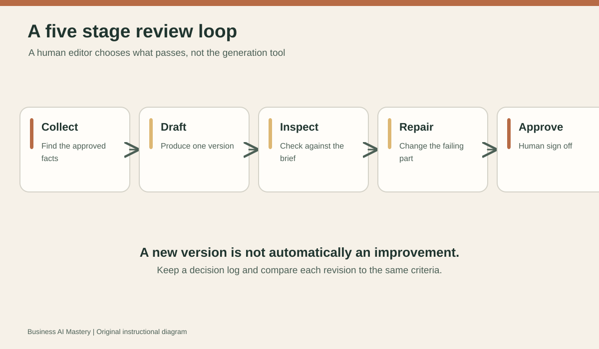

# START HERE

This is a course, not a prompt collection to paste without thinking. You will get better results if you start with a business decision, prepare the evidence, make one asset and inspect it before attempting a complicated automated system.

## A useful first 90 minutes

**First 15 minutes: choose a task.** Pick one recurring question such as “Which products moved slowly last week?” or “How do I explain the new opening hours?” Write what a correct answer must contain. Do not use private financial or customer information in a test project.

**Next 20 minutes: prepare context.** Create a short approved brief and a source inventory. Mark any guesses and old files as nonauthoritative. Read [context engineering](01-foundations/context-engineering.md).

**Next 20 minutes: prompt and inspect.** Use the [prompt anatomy](01-foundations/prompting-fundamentals.md) and try one of the [business assistant](02-business-management/chatgpt.md) examples. Ask for evidence and missing information before the final output.

**Next 20 minutes: repair.** Apply the [humanisation](01-foundations/humanization.md) and [quality checklist](06-reference/quality-checklists.md). Correct real defects: unsupported claims, wrong arithmetic, long sentences, visual confusion or inaccessible captions.

**Final 15 minutes: record what worked.** Save the source, draft, revision request and final version. Note whether you actually saved time after review. The result is a tested workflow, not an inspirational list of prompts.

## Suggested four week study path

| Week | Study | Deliverable |
| --- | --- | --- |
| 1 | Foundations, prompting, context, source files | Approved brief and evidence ledger |
| 2 | Business tools, weekly reporting, customer workflow | One checkable management report |
| 3 | Humanisation, graphic design, images, video and voice | One truthful campaign asset set |
| 4 | Publishing, results and automation | One approved process and improvement note |

## Choose the right practical route

| Your job | Essential reading | Next hands-on lesson |
| --- | --- | --- |
| Improve written copy | [Humanisation](01-foundations/humanization.md) | [Brand voice](01-foundations/brand-voice-and-visual-systems.md) |
| Design a campaign | [Visual language](01-foundations/camera-lighting-and-visual-language.md) | [Campaign workflow](04-practical-workflows/marketing-campaigns.md) |
| Manage finance and stock | [Working with data](01-foundations/working-with-files.md) | [Cash review](04-practical-workflows/financial-analysis.md) and [inventory](04-practical-workflows/inventory-procurement-and-suppliers.md) |
| Make narrated video | [Multimodal content](01-foundations/multimodal-content.md) | [Video and voice](04-practical-workflows/video-and-voice.md) |
| Improve customer operations | [Business strategy](01-foundations/business-ai-strategy.md) | [Support workflow](04-practical-workflows/customer-service-and-support.md) |
| Build reliable automation | [Verifying results](01-foundations/verifying-results.md) | [Approval-first automation](04-practical-workflows/business-automation.md) |

## Two rules for practising in public

Use fictional or fully sanitised business records. Never commit a password, customer account, address list, payment record, confidential client brief or unreleased product information to this repository. Use genuine permissions for photographs, voice and any testimonial. The example images are illustrative, not actual product evidence.

## What to read next

* For a shop: [Retail case](05-real-world-examples/retail-shop.md) and [QuickBooks](02-business-management/quickbooks.md).
* For marketing: [Full campaign](05-real-world-examples/complete-campaign.md) and [Canva](03-content-creation/canva.md).
* For filmmaking: [Video and voice workflow](04-practical-workflows/video-and-voice.md) and [Runway](03-content-creation/runway.md).
* For workflows: [Automation with approval](04-practical-workflows/business-automation.md) and [Zapier](02-business-management/zapier-agents.md).

[Return to the repository homepage](README.md)
